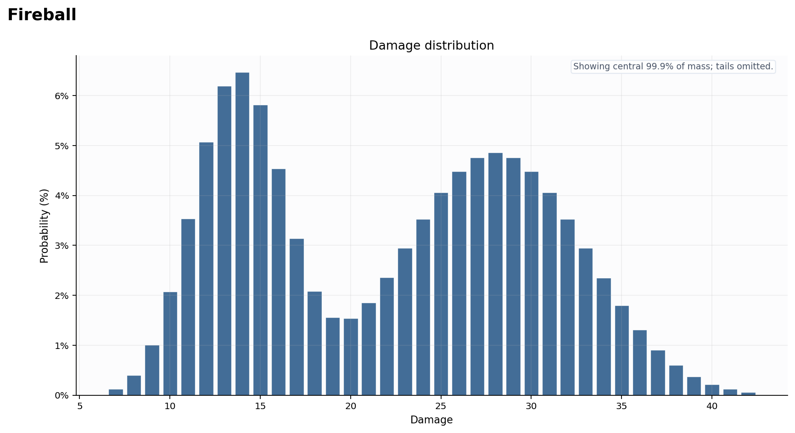
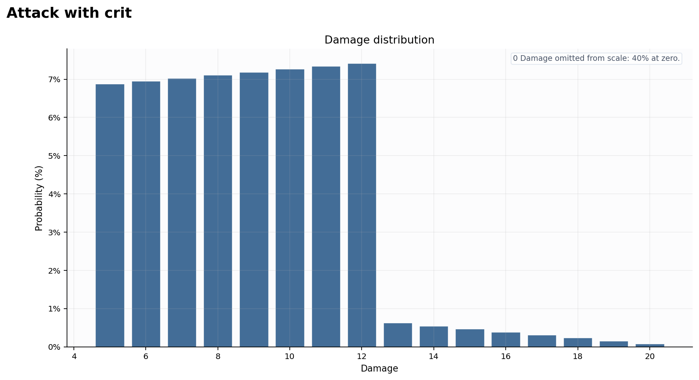
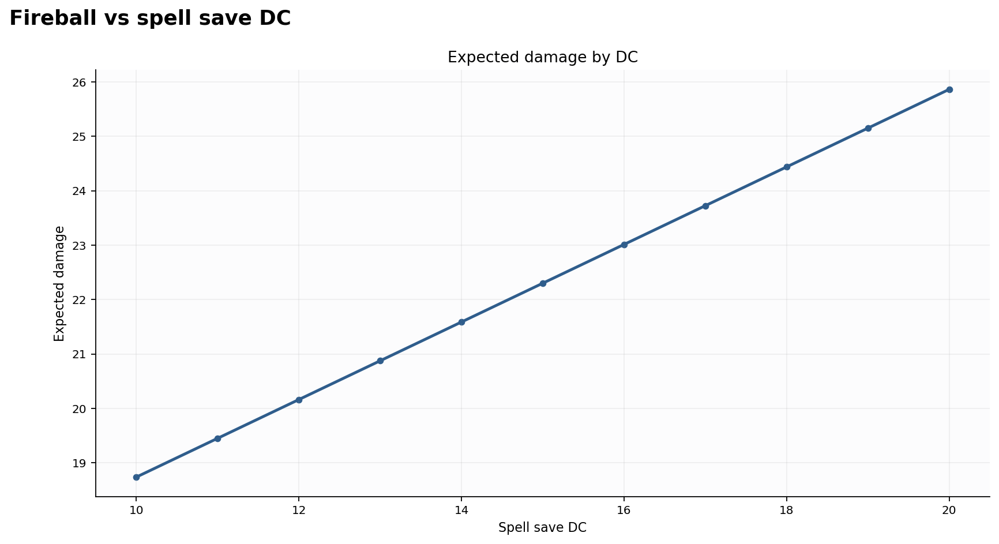
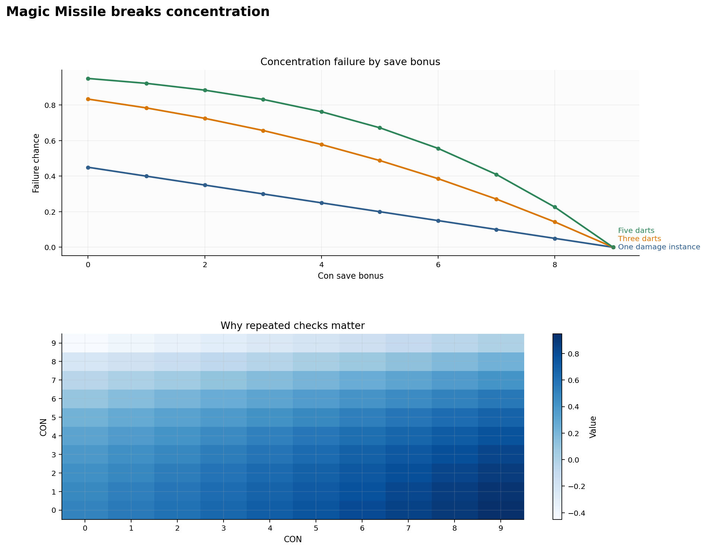
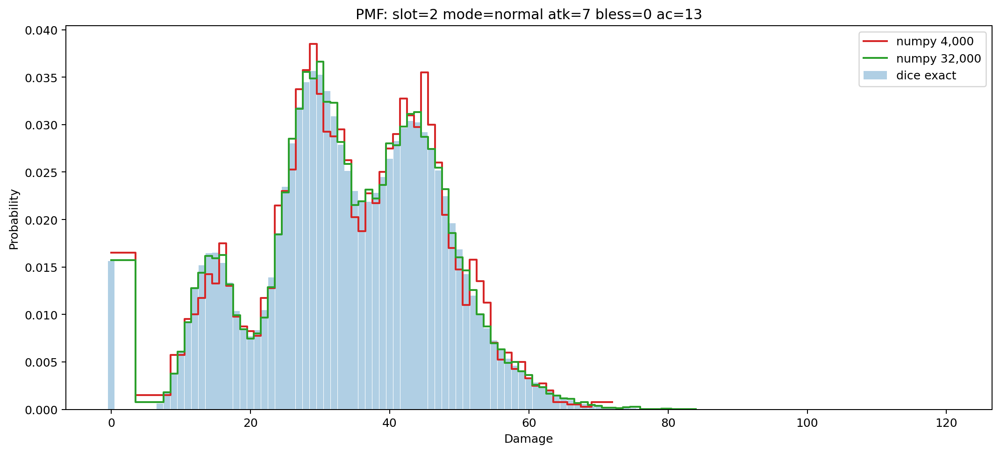

# dice

`dice` is a language for tabletop dice and probability calculations that keeps common RPG math readable while extending effortlessly to parameter studies and report generation. Dice is easily user extensible through Python. 
You can test dice in a [web demo](https://felixmueh.github.io/dice-web/) but please note that the local version is more mature and better tested.

[Web version](https://felixmueh.github.io/dice-web/) · [Installation](#installation) · [Usage](#usage) · [Language manual / API docs](manual/index.md) · [Examples](examples/README.md) · [Python extension](#python-extension)

`dice` is inspired by [AnyDice](https://anydice.com/) and Troll. Troll is also used in this repository for parity testing.

## Start Here

These are some of the calculations `dice` is built to make easy:

```dice
# mean ability score: 12.24
4d6h3 $ mean
# fireball damage
d20 + 2 >= 15 -> 8d6 // 2 | 8d6
# attack with crit
split d20 | == 20 -> 2 d 8 + 4 | + 7 >= 16 -> 1 d 8 + 4 ||
# fireball damage over spell save DC
d20 + 2 >= [DC:10..15] -> 8d6 // 2 | 8d6 $ mean
```

Rendered as three side-by-side views:

<table>
  <tr>
    <td></td>
    <td></td>
    <td></td>
  </tr>
  <tr>
    <td align="center">Fireball damage distribution</td>
    <td align="center">Attack with crit</td>
    <td align="center">Fireball over spell save DC</td>
  </tr>
</table>

Dice can also be used to generate reports and re-usable function libraries. See [Examples](examples/README.md) for more examples.

```dice
import "std:dnd/core"

maintain_once(con_bonus):
    save_success(10, con_bonus) $ mean

maintain_per_dart(darts, con_bonus):
    (((save_success(10, con_bonus)) ^ darts) == darts) $ mean

one_check = 1 - maintain_once([CON:0..9])
three_darts = 1 - maintain_per_dart(3, [CON:0..9])
five_darts = 1 - maintain_per_dart(5, [CON:0..9])

r_title("Magic Missile breaks concentration")
r_hero(r_compare(("One damage instance", one_check), ("Three darts", three_darts), ("Five darts", five_darts), x="Con save bonus", y="Failure chance", title="Concentration failure by save bonus"))
r_row(r_auto(five_darts - one_check, x="Con save bonus", y="Extra failure chance", title="Why repeated checks matter"))
render()
```




## Stage 1: Minimal TTRPG calculations

Common TTRPG calculations:

```dice
d20 >= 15
d20 >= 15 -> 8 | 0
4d6h3
import "std:dnd/core"; save_half(15, 2, 8 d 6)
import "std:dnd/weapons"; longsword_attack(16, 7, 4)
```

These examples cover:

- success chance
- damage on success or failure
- classic character-generation rolls
- saving throw damage
- imported combat helpers

The same expressions also work across many inputs:

```dice
(d20 + 7 >= [AC:10..20] -> 8 | 0) $ mean
attack_damage(ac, bless=0): (d20 + (bless -> d4 | 0) + 7 >= ac -> 8 | 0) $ mean; attack_damage([AC:10..20], [BLESS:0, 1])
```

Parameter studies are part of the language. You can sweep over AC, spell save DC, level, strategy, or toggles like `bless` without switching tools.

### Common Pitfalls

Two common mistakes are about independence:

```dice
2d6 == 7
(2 * d6) == 7
d6 ^ 2
(d6 + 1) ^ 2
```

- `2d6` means two independent `d6` rolls added together.
- `2 * d6` doubles one sampled `d6` result, which is a different distribution.
- `d6 ^ 2` means independent repetition and summation, not exponentiation.
- `(d6 + 1) ^ 2` repeats the whole expression independently twice.

`split` is the other important early pitfall. It reuses one sampled value across branches, which is exactly what you want for crit/hit/miss logic, but it is not a sequence of fresh rolls.

## Stage 2: Practical Language Features

### Functions And Variables

Small functions are enough for a lot of reusable combat logic:

```dice
hit(ac, bonus=7): d20 + bonus >= ac
damage(ac, bonus=7): hit(ac, bonus) -> 8 | 0

hit(16)
damage([AC:10..18])
```

Defaults keep common variants compact, and named helpers make larger studies easier to read.

### Sweeps

Sweeps are the main way to compare many cases:

```dice
d20 >= [AC:10..20]
(d20 + 7 >= [AC:10..20] -> 8 | 0) $ mean
attack_damage(ac, bless=0): (d20 + (bless -> d4 | 0) + 7 >= ac -> 8 | 0) $ mean
attack_damage([AC:10..20], [BLESS:0, 1])
```

Sweeps work almost anywhere in the language, so multi-case studies stay close to the one-case version.

### Imports And Reuse

Imports are explicit and file-based:

```dice
import "std:dnd/weapons"; longsword_attack(16, 7, 4)
import "std:dnd/core"; save_half(15, 2, 8 d 6)
```

Use relative imports for your own helper files, and `std:...` for the packaged standard library.

### split

Use `split` when one roll must drive several decisions:

```dice
split d20 | == 20 -> 16 | + 7 >= 16 -> 8 ||
split d20 as roll | roll == 20 -> 16 | roll + 7 >= 16 -> 8 ||
```

This is useful for crit logic, death saves, exploding-style conditions, and other rules where one die result controls several outcomes. Later clauses only see what earlier clauses did not already match.

### Basic Stochastic Operations

Built-in summary operations cover the usual probability questions:

```dice
d20 $ mean
d20 $ sample
d20 $ var
cum(d20)
surv(d20)
```

- `mean` for expected value
- `sample` for one concrete draw
- `var` and `std` for swinginess
- `cum` and `surv` for “at most” and “at least”

### Rendering

Rendering uses the same expressions:

```dice
r_title("Expected damage vs AC"); r_auto((d20 + 7 >= [AC:10..20] -> 8 | 0) $ mean, x="AC", y="Expected damage"); render()
```

That keeps the calculation and the chart in one file.

## Python Extension

`dice` is designed to extend cleanly with Python.

Common workflows:

1. import trusted Python helper modules into `dice`
2. call `dice` from Python for postprocessing, tooling, or larger applications

Import a Python helper module like this:

```dice
import "examples/02_python_extensions/basic_library.py"; add_two([1..3])
```

The Python side exports functions with `@dicefunction`:

```python
from dice import dicefunction

@dicefunction
def add_two(value):
    return value + 2
```

You can also call `dice` from Python:

```python
from dice import dice_interpreter, dicefunction

session = dice_interpreter()
result = session("d20 >= [AC:10..12] -> 5 | 0")

@dicefunction
def add_two(value):
    return value + 2

session.register_function(add_two)
again = session("add_two([1..3])")
```

The main runtime types are:

- `Distribution` for probability mass
- `FiniteMeasure` for weighted finite values
- `Sweep[T]` for parameter studies
- tuples and records for structured values and coordinates

Typed Python parameters can receive whole distributions or whole sweeps rather than individual projected cell values. See the [Python integration manual page](manual/reference/python-integration.md) and [Python extension examples](examples/02_python_extensions/README.md) for details.

## Language Features At A Glance

Major features:

- exact dice distributions and arithmetic
- conditional expressions for hit, save, and branch logic
- named sweeps for parameter studies
- reducers such as `sumover(...)`, `meanover(...)`, and `argmaxover(...)`
- `split` for shared-roll logic
- report builders such as `r_auto(...)`, `r_compare(...)`, and `render(...)`
- imports for reusable dice code and Python helpers
- Python embedding and extension APIs

For the full language reference, see the [language manual](manual/index.md). For more worked examples, see [examples/README.md](examples/README.md).

## Installation

The local version is currently the most complete way to use `dice`.

```bash
git clone https://github.com/felixmueh/dice.git
cd dice
python3 -m venv .venv
. .venv/bin/activate
pip install -r requirements.txt
python3 -m dice "d20 >= 15 -> 8 | 0"
```

`python3 -m dice` runs the `dice/` package from the repository root. To get a
`dice` command that works from any directory, install the checkout instead:

```bash
pip install -e .
dice "d20 >= 15 -> 8 | 0"
```

If you also want to build the documentation site locally:

```bash
pip install -r requirements-docs.txt
mkdocs serve
```

## Usage

The CLI has three main modes:

```bash
python3 -m dice --interactive
python3 -m dice "d20 >= 11 -> 5"
python3 -m dice --file path/to/program.dice
```

Useful flags:

- `-R N` or `--round N` to round displayed numeric output
- `--json` to emit structured JSON
- `-v` to print the input together with the result

Many output and rendering settings can also be set inside a dice program or an interactive session:

- `$ set_round N`
- `$ set_render_mode blocking|nonblocking|deferred`
- `$ set_probability_mode percent|raw`
- `set_render_autoflush("on" | "off")`
- `set_render_omit_dominant_zero("on" | "off")`

That means you can keep output preferences close to the program that produces the result.

## Similar Projects

- [AnyDice](https://anydice.com/) is the classic browser-based dice calculator and one of the main inspirations for this project.
- Troll is another dice language with strong dice-pool algebra. `dice` uses Troll for parity testing on part of its behavior.

## Performance

`dice` is an exact engine, not a Monte Carlo sampler. For many additive RPG calculations that makes it both more accurate and surprisingly fast. For heavily branching workloads, Monte Carlo can still be the better fit.

For the representative `hexed_scorching_ray` cell `slot=2, mode=normal, atk=7, bless=0, ac=13`, the exact PMF and the vectorized Monte Carlo overlays look like this:



For benchmark details and scripts, see [benchmarks/README.md](benchmarks/README.md).

## Development Note

The `dice` examples in this README are executed by the test suite. If you change syntax or semantics, update the examples and the runtime together.
